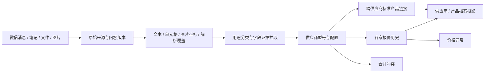

# 供应商、产品与报价档案设计（M2）

状态：只读盘点后的设计稿，未实现、未迁移、未部署。依据 `docs/north-star.md`，尤其是第 2、3、4、5 节。本文件只含结构和规则；现场数量、文件身份和样本证据留在被忽略的私有输出目录。

## 目标与边界

把微信聊天、微信笔记及其中的附件、Word、Excel、PDF、图片整理为可持续更新的供应商档案、品类→型号→配置档案，以及每家供应商独立的报价历史。同款跨供应商共享标准产品身份，每家的工厂型号、配置、报价和出处仍然保留。只报部分型号时，只记录实际报价；其余显示“未报价”。

建档可以自动持续进行。业务人工审核只有合并冲突、价格异常两类；格式失败自动重试或记录失败继续其他材料，信息缺失保留未知。资料中的指令只是正文，不能触发执行、联网或发送。对外消息、收款确认和商品发布仍遵守总纲中由老板操作的红线。

## 已读源码与兼容边界

以下名称已经核对现场源码及真实 SQLite `table_info`；这里不声明它们已经满足新设计。数据库路径由运行配置注入，禁止把本设计当作生产迁移脚本。

| 现有位置 | 已核对的数据接口 | 设计影响 |
| --- | --- | --- |
| `console/supplier_data/catalog_reader.py` | `equipment_specs`、`multimedia_assets`、`knowledge_chunks`；按 `equipment_id` 归属证据，只读打开 | 可复用读取和包装提取；规格记录不能直接视为标准产品；不能按名称把证据移给其他产品 |
| `supplier_knowledge/catalog.py`、`sources.py`、`extractors.py` | 资产版本、文件 SHA256、`rows` 中的 locator/evidence_id、字段证据、文本/图像预算与解析限制 | 复用解析文本，补齐页/行/单元格及完整度；解析限额不代表材料全量完成 |
| `console/data.py`、`v3_B.py` | `/v3/suppliers` 读 `kb_supplier_profile`；`/v3/products` 读 `kb_product` | 这是旧投影，不能把旧页面数量当作新档案库数量 |
| `console/archive/store.py`、`migration_v2.py`、`seed.py`、`service.py` | `parties`、`identities`、`products`、`product_sources`、`offers`、`product_merges` | `products.supplier_id` 目前绑定单家；`offers` 通过 `product_id` 间接归属供应商；旧合并只允许同供应商，不能用于跨供应商同款合并 |
| 现有目录库的 `cat_*` 表 | `cat_supplier`、`cat_supplier_model`、`cat_supplier_offer`、`cat_product`、`cat_product_link` | 保留旧 ID 映射，不在本次设计中删除、重建或把旧报价重复导入 |
| `console/directory/service.py`、`sources.py`、`roles/common.py`、`roles/triage.py` | 配置角色、消息 scope、SUP/CUS 名称规则与冲突标记 | 群角色、个人联系人、法人供应商分别统计；群成员身份不自动成为供应商身份 |
| `console/wechat_business_search.py`、`wechat_business_search_runtime.py`、`owner_inbox.py` | 权限、绑定、scope、cutoff、原始哈希、当前会话复核 | 前两者自述 candidate / not installed，不能据文件存在断言线上启用；复用来源验证契约，不调用会写入的初始化函数 |
| `console/extract/rules.py`、`service.py` | 现有文字报价抽取、`extraction_suggestions` | 当前规则声明不读附件；附件建档需要新解析适配器，不能靠扩大文字消息窗口代替 |

现有归档 HTTP 接口已在 `v3_archive_api.py` 核对：`GET /api/v1/archive/summary`、`parties`、`parties/{id}`、`products`、`products/{id}`；写接口包含 `POST products/{id}/merge`、`products/{id}/offers`、`offers/{id}/status`。本任务未请求这些接口。已有 `offers.price_fen` 是整数，但字段名和默认币种不足以表达全部币种、含税条件和未报价状态，新表不能直接继承其默认值。

## 数据流

下列 `sd_*` 名称均为**拟新增**表和字段，采用独立命名空间。初期写隔离候选库；原始业务库一直只读。上线时再确定独立库或同库新表，不在设计阶段执行 DDL。

所有幂等唯一键必须落实为非空字段或非空规范键，不能依赖 SQLite 对 NULL 的 UNIQUE 行为。未知业务值仍存 NULL，另生成用于去重的规范键；无子项的序号用明确哨兵，无 blob 的来源版本用独立内容版本键。该去重机制不构成“两个未知配置相同”的合并证据。

## 原始层：同一内容与不同出处分开

| 拟新增表 | 核心字段与类型 | 约束与作用 |
| --- | --- | --- |
| `sd_source` | `source_id TEXT PK, tenant_id TEXT, channel TEXT, account_ref TEXT, conversation_ref TEXT, message_ref TEXT, parent_source_id TEXT, child_ordinal INTEGER, sender_ref TEXT, direction TEXT, role_at_observation TEXT, role_proof_ref TEXT, owner_ref TEXT, source_scope TEXT, source_created_at TEXT, received_at TEXT` | UNIQUE(tenant_id, channel, account_ref, conversation_ref, message_ref, child_ordinal)；文件导入由适配器生成稳定 message_ref；转发/笔记子项保留父链 |
| `sd_blob` | `blob_sha256 TEXT PK, byte_size INTEGER, media_type TEXT, storage_ref TEXT, storage_tier TEXT, availability TEXT, checked_at TEXT` | 内容去重只共享字节；来源、权限和供应商归属不因哈希相同被合并；storage_ref 为服务端受控引用 |
| `sd_source_version` | `version_id TEXT PK, source_id TEXT FK, blob_sha256 TEXT FK NULL, payload_sha256 TEXT, observed_at TEXT, source_modified_at TEXT NULL, supersedes_version_id TEXT NULL, revision INTEGER, availability TEXT, integrity_state TEXT` | UNIQUE(source_id, payload_sha256, blob_sha256)；更正追加版本；纯文字仍有 payload_sha256；暂时掉盘不能当作撤回 |
| `sd_source_legacy_ref` | `version_id TEXT FK, legacy_store TEXT, legacy_table TEXT, legacy_key_json TEXT, legacy_hash TEXT` | UNIQUE(legacy_store, legacy_table, legacy_key_json, legacy_hash)；精确映射复合键，拒绝仅凭 message_id 跨账号连接 |

微信原始键从真实来源读取：`messages(app_id,message_id)`、`company_media(app_id,message_id,ordinal)`、`company_note_assets` 的父子序号与 `asset_id`。笔记正文可读不等于笔记图片/文件已读。`received_callback_archive`、`outbound_callback_archive` 保留方向证据；无法证明方向时记 unknown，不能把发给供应商的需求清单当成其规格承诺。

本地归档、NAS 文件与数据库 BLOB 分别核验。登记大小是引用累计，物理占用按文件系统统计，去重内容按 SHA256 统计；三者不能相加。加密桌面库、图片 `.dat` 不凭后缀假称已经解析。读取 SQLite 使用 `mode=ro`、`query_only` 和单库事务；活动 WAL 必须可读且已存在 shm。只对无活动 WAL 的静态库考虑 immutable，避免漏掉尚未 checkpoint 的提交。跨库读取记各自时间，不能宣称为全局同一快照。

## 解析层：保留行列关系和覆盖范围

| 拟新增表 | 核心字段与类型 | 约束与作用 |
| --- | --- | --- |
| `sd_parse_run` | `parse_id TEXT PK, version_id TEXT FK, parser_name TEXT, parser_revision TEXT, options_sha256 TEXT, state TEXT, page_count_total INTEGER NULL, page_count_done INTEGER, sheet_count_total INTEGER NULL, row_count_done INTEGER, text_chars INTEGER, coverage_json TEXT, started_at TEXT, finished_at TEXT NULL, error_code TEXT NULL` | UNIQUE(version_id, parser_name, parser_revision, options_sha256)；state 为 queued/running/partial/ready/no_text/failed；部分读取不能变为 ready |
| `sd_segment` | `segment_id TEXT PK, parse_id TEXT FK, segment_kind TEXT, page_no INTEGER NULL, sheet_name TEXT NULL, row_start INTEGER NULL, row_end INTEGER NULL, cell_range TEXT NULL, paragraph_no INTEGER NULL, bbox_json TEXT NULL, text_ref TEXT, text_sha256 TEXT, order_no INTEGER, confidence_bp INTEGER NULL, image_sha256 TEXT NULL` | UNIQUE(parse_id, order_no)；原文放私有文本对象；locator 可准确打开页、单元格或图片区域 |

解析按格式自动选择：DOC/DOCX 保留段落和表格；Excel 同时读取表头、合并区域、空单元格位置、公式及已有缓存值，不执行宏、公式和外链；PDF 先文本及布局，再对无文本区域 OCR；图片先分区再识别，报价卡片的名称和价格使用同一 bbox 组。双栏 PDF、海报网格不能先展平成一段文字再猜配对。

对同后缀异格式做 magic 检测。嵌图、超大文档、超页数、公式无缓存、表头跨页都写 coverage_json。分段可续跑、按页/表 checkpoint；不得静默丢弃后半部分。压缩包可登记，未来在受控目录安全展开后逐个子文件建来源，不把包内未读部分计入已解析。

## 条目层：先辨用途，再抽事实

| 拟新增表 | 核心字段与类型 | 约束与作用 |
| --- | --- | --- |
| `sd_extract_run` | `extract_id TEXT PK, parse_id TEXT FK, window_sha256 TEXT, schema_revision TEXT, prompt_sha256 TEXT, provider TEXT, model_revision TEXT, state TEXT, input_tokens INTEGER NULL, output_tokens INTEGER NULL, started_at TEXT, finished_at TEXT NULL, error_code TEXT NULL` | UNIQUE(parse_id, window_sha256, schema_revision, prompt_sha256, model_revision)；模型输出不直接写正式档案 |
| `sd_item` | `item_id TEXT PK, extract_id TEXT FK, document_purpose TEXT, item_kind TEXT, supplier_local_ref TEXT NULL, manufacturer_model TEXT NULL, product_label TEXT NULL, config_json TEXT, quote_payload_json TEXT NULL, evidence_state TEXT, payload_sha256 TEXT` | 用途含 supplier_quote/specification/manual/buyer_requirement/listing_template/marketing/unknown；kind 区分产品、报价、服务、套装、非产品；模板和买家需求不能生成供应商有效报价 |
| `sd_field_evidence` | `item_id TEXT FK, field_path TEXT, segment_id TEXT FK, span_start INTEGER NULL, span_end INTEGER NULL, cell_ref TEXT NULL, bbox_json TEXT NULL, evidence_kind TEXT, confidence_bp INTEGER, value_sha256 TEXT` | PK(item_id, field_path, segment_id, value_sha256)；型号、规格、价格、MOQ、交期、税、币种各有独立证据 |

抽取窗口按供应商/会话连续上下文及文档表格组成，不再孤立读一条消息。上下文中明确的更正、币种、税、批量条件可以绑定相关行；缺证据则记 unknown，不能跨供应商或跨不相干日期继承。总价、单价、样品价、阶梯价、运费、箱价、配件价各自建条目。需求数量不是 MOQ，光源功率不是整机功耗，工作电压和 DMX 通道数不能当价格。

## 实体层：标准同款与供应商商品分开

| 拟新增表 | 核心字段与类型 | 约束与作用 |
| --- | --- | --- |
| `sd_party_role` | `party_id INTEGER FK parties(id), role TEXT, supplier_subtype TEXT NULL, evidence_ref TEXT, valid_from TEXT, valid_to TEXT NULL` | 同一往来单位可同时有客户/供应商角色，供应商分产品/物流/配套；不删除旧 parties.kind |
| `sd_identity_link` | `link_id TEXT PK, source_identity_ref TEXT, party_id INTEGER NULL, supplier_local_ref TEXT, relation TEXT, confidence_bp INTEGER, evidence_ref TEXT, state TEXT, valid_from TEXT, valid_to TEXT NULL` | relation 为代表/参与者/群关联；群内成员不自动全属于同一公司；未知身份先有独立本地档案，冲突才进合并审核 |
| `sd_category` | `category_id TEXT PK, parent_id TEXT NULL, label TEXT, taxonomy_revision TEXT` | 品类树，与供应商及型号分离 |
| `sd_model` | `model_id TEXT PK, category_id TEXT FK, canonical_label TEXT, manufacturer_ref TEXT NULL, identity_signature TEXT, revision INTEGER` | 相同营销名或相同功率不足以自动合并 |
| `sd_variant` | `variant_id TEXT PK, model_id TEXT FK, config_signature TEXT, config_json TEXT, revision INTEGER` | UNIQUE(model_id, config_signature)；光源/功率口径、色温、光学、CMY/CTO、IP、接口、箱装方案等区分配置；unknown 不是相等值 |
| `sd_supplier_sku` | `supplier_sku_id TEXT PK, party_id INTEGER NULL, supplier_local_ref TEXT, factory_model_raw TEXT NULL, factory_model_norm TEXT NULL, config_signature TEXT, source_item_id TEXT FK` | 不要求工厂型号必填；无型号时用独立来源指纹防串；supplier_local_ref 在 party 未定时仍稳定 |
| `sd_alias` | `alias_id TEXT PK, entity_kind TEXT, entity_id TEXT, alias_norm TEXT, supplier_local_ref TEXT NULL, source_item_id TEXT FK` | 别名有供应商边界，不做全局同名唯一 |
| `sd_product_link` | `link_id TEXT PK, supplier_sku_id TEXT FK, variant_id TEXT FK, state TEXT, rule_revision TEXT, evidence_json TEXT, score_bp INTEGER, decided_at TEXT, supersedes_link_id TEXT NULL` | 每个 SKU 至多一个 active 标准配置链接；追加撤销事件，合并可逆；不移动、覆盖其他供应商报价 |
| `sd_legacy_product_map` | `legacy_store TEXT, legacy_product_ref TEXT, supplier_sku_id TEXT FK, variant_id TEXT NULL, migration_revision TEXT` | PK(legacy_store, legacy_product_ref)；旧 product_id、equipment_id、cat_supplier_model 等保留精确映射 |

合并先做单位/字符规范化和确定性 blocking，再比较小规模候选。已确认同一生产型号与完整配置、证据兼容的可自动链接；同名异参数、同功率异结构、缺关键属性无法区分、已有身份一对多冲突进入 merge_conflict。明确不同款则自动分开，普通缺字段继续建档。外观相似、向量近似只用于召回，不能独立证明同款。

## 报价层：每家、每配置、每条件、每日期各存一条

| 拟新增表 | 核心字段与类型 | 约束与作用 |
| --- | --- | --- |
| `sd_quote` | `quote_id TEXT PK, supplier_sku_id TEXT FK, source_item_id TEXT FK, amount_minor INTEGER NULL, amount_decimal TEXT NULL, currency TEXT NULL, minor_unit_exponent INTEGER NULL, unit TEXT NULL, price_kind TEXT, quote_state TEXT, tax_basis TEXT, tax_rate_bp INTEGER NULL, incoterm TEXT NULL, includes_case TEXT, qty_min INTEGER NULL, qty_max INTEGER NULL, moq_units INTEGER NULL, lead_days_min INTEGER NULL, lead_days_max INTEGER NULL, lead_text TEXT NULL, terms_json TEXT, quoted_at TEXT NULL, quoted_at_basis TEXT, valid_until TEXT NULL, supersedes_quote_id TEXT NULL, created_at TEXT` | UNIQUE(source_item_id, supplier_sku_id, price_kind, qty_min, qty_max) 的空值须用非空规范键实现；amount 不用浮点；NULL≠0；支持 JPY 等非两位小数币种；未能规范化时保留十进制文字候选，禁止强填币种 |
| `sd_review` | `review_id TEXT PK, review_kind TEXT, subject_ref TEXT, input_revision TEXT, reason_code TEXT, alternatives_json TEXT, state TEXT, decision_json TEXT NULL, decided_by TEXT NULL, decided_at TEXT NULL` | review_kind 只允许 merge_conflict / price_anomaly；来源版本改变后旧审核结论不能自动沿用 |

`quote_state` 区分 unquoted/observed/ambiguous/superseded/retracted；“未报价”优先由供应商 SKU 与报价的左连接投影，不制造金额为零的报价。报价金额存在但型号不能归属时保留 ambiguous 条目；归属冲突进入合并队列。未知税制、币种、单位、有效期与未报价分别显示，不能统一称为“有效价格”。

日历日期、消息时间、文件 mtime 分开。quoted_at_basis 为 explicit/message_context/unknown，mtime 不能当报价日期；无有效期保留历史参考，不能自动填一个截止日。兼容原报价轮的有效期校验：没有有效成本证据时继续阻止使用，不为迁移放宽原业务约束。

价格异常包括非正常数量级、币种不明、OCR 数字冲突、价与型号错列、混用总价/单价、零负价、同配置同条件突变。阈值是拟定规则：同币种/税制/单位/配置/数量档可比后，价格相对历史中位数变化超过 30% 或偏离超过 3 MAD 标记候选；小样本仅作提示，不自动修价。正常新报价自动建档；缺交期和 MOQ 不额外要求人工补录。

## 档案层与接口草案

`sd_dossier_revision(dossier_revision_id TEXT PK, entity_kind TEXT, entity_id TEXT, input_epoch TEXT, generator_revision TEXT, body_json TEXT, field_sources_json TEXT, completeness_json TEXT, built_at TEXT)` 保存不可变档案版本；`sd_dossier_head(entity_kind TEXT, entity_id TEXT, dossier_revision_id TEXT FK)` 以双字段主键切换当前版本。供应商档案展示身份、主营品类、供货型号、资料目录与覆盖缺口；产品档案按品类→型号→配置展示各家 SKU 和报价历史。

拟新增 `GET /api/v1/dossiers/suppliers/{id}`、`GET /api/v1/dossiers/models/{id}`、`GET /api/v1/dossiers/variants/{id}/quotes`、`GET /api/v1/dossiers/evidence/{id}`，返回档案版本、字段状态、受控来源定位与覆盖范围。`GET /api/v1/dossiers/reviews?kind=...`、`POST /api/v1/dossiers/reviews/{id}/decision` 仅处理两类人工异常，须认证、CSRF、版本匹配和幂等请求键。以上是接口草案，本次没有新增路由。

worker 内部使用 `discover(cursor) -> source_versions`、`parse(version_id, parser_revision) -> segments`、`extract(parse_id, window_sha) -> items+evidence`、`resolve(item_ids) -> links+reviews`、`project(entity_id, input_epoch) -> dossier_revision`。入口接收服务端绑定的 scope，不信任客户端提供的任意数据库、路径或账号。客户回复用途继续排除成本价、供应商保密信息和其他买家会话，老板内部档案可查看获授权资料。

## 增量、恢复与模型分工

拟新增 `sd_job(job_id TEXT PK, stage TEXT, input_ref TEXT, input_revision TEXT, tool_revision TEXT, state TEXT, attempts INTEGER, not_before TEXT, lease_until TEXT NULL, cursor_json TEXT, error_code TEXT NULL, started_at TEXT NULL, finished_at TEXT NULL)`，UNIQUE(stage,input_ref,input_revision,tool_revision)。另设 `sd_cursor(adapter_id TEXT PK, watermark_json TEXT, last_source_hash TEXT, reconciled_at TEXT)`。job 完成与对应层输出在同一事务提交；租约到期可接管，幂等键保证只产出一次有效结果。

消息游标使用真实单调 rowid/接收序号加锚点，时间戳只辅助，避免迟到消息漏采。附件使用 `(source_id, payload_sha256, blob_sha256)` 观察新版本；文件先比 size/mtime，再按需重算 SHA。正常版本变更只重算对应解析、条目和受影响的实体档案。更正追加 supersedes，不覆盖报价历史；来源撤回单独标记并重新投影。模型/提示词更新是新 run，不覆盖旧字段证据。

| 步骤 | 首次全量 | 日常增量 |
| --- | --- | --- |
| 哈希、版本登记、格式解析、基础单位/币种校验 | 本地确定性工具 | 同样工具；不消耗聊天模型 |
| 文档用途与型号/配置/报价抽取 | Codex 按整份文档/表格分批，输出严格结构与字段证据 | DeepSeek 处理文字/普通表格；Qwen 处理图像布局与复杂表格，按现场实际可用模型版本配置 |
| 同款候选匹配 | 规则 blocking + Codex 校核非确定性候选 | 规则 blocking + DeepSeek；多模态差异交 Qwen；不能判定则保留独立条目或进入冲突队列 |
| 数字与异常校验 | 本地约束；仅异常触发第二模型交叉核对 | 同上；不能把每一条都双读成固定成本 |
| 档案组织 | 确定性字段聚合，Codex 辅助文字摘要 | 确定性聚合，DeepSeek/Qwen 仅处理变更内容 |

模型身份、revision、token 计量与失败码落 run 表。单条失败退避重试后记录失败，继续其他来源；批量额度用可配置并发、速率与日预算调度，不能回到每轮只处理少量固定条目的限制。没有单独给模型做权重训练。

## 工作量与时间的估算方法

公开设计不放现场数据。私有报告提供实测字符数、去重文件数、现有本地 tokenizer 的参考计数、明确假设的生成 token 区间和工期。参考 tokenizer 不是 Codex/DeepSeek/Qwen 的准确计费 tokenizer，不能称为实际模型 usage。

估算输入量为去重文本 token ×（表头/上下文重复系数）+ 提示词 + 新增 OCR 文本；输出另按条目数计；实体合并只比较 blocking 后候选，不做全表两两比较。耗时分解析/OCR、抽取、合并和投影：`模型墙钟时间≈调用数×单次延迟÷有效并发`，再加重试与额度等待。提供单并发及拟定并发两种假设。缺原件、加密数据、未接入的微信历史与未知 OCR 页数单列，不纳入可保证完工时间。实施阶段先测小批真实 usage 再修正全量估算；本任务不调用生产模型作压测。

## 后续实施与验收

1. 固化只读适配器和来源键，建独立候选库；从已有解析结果复用，不重复 OCR 已有可验证文本。所有异常、无文本和部分解析都计入覆盖分母。
2. 在合成夹具验证税/币种/套装/阶梯价/部分型号/笔记子项/晚到消息/更正/重试；再用私有匿名样本核对逐字段证据，不把设计阶段的可提取性评估当作准确率。
3. 回填供应商 SKU 和历史映射；跨供应商同款只新建链接，保留旧 products 和 offers。验证每条报价仍归原供应商，重复回放不重复报价，合并撤销可恢复独立身份。
4. 新增只读档案投影并对账：一层失败不假报完成；每个字段可点回页/行/图；未报价、未知条件、历史过期与来源不可读分别显示。业务人工队列只能有两类。
5. 生产发布属于另一个实施任务：候选测试通过后，备份受影响库与 WAL 一致性状态、明确迁移版本、主动迁移、装入路由、重启与验收；遵守仓库上线前 e2e 要求。当前没有实现包、迁移文件或安装命令可执行，不能把这些步骤理解为已授权本次发布。
6. 回滚以停用新 worker/新只读投影、回切旧路由和旧档案 head 为先，保留原库及报价 ID。若将来迁移改写旧表，必须另备经过验证的数据库恢复步骤，不能仅回滚代码。

未完成：生产候选实现、字段抽取准确率基准、跨供应商同款准确率与撤销测试、完整原件覆盖核验、真实模型吞吐/usage 基准、迁移和生产发布。本设计不代表这些能力已上线。
